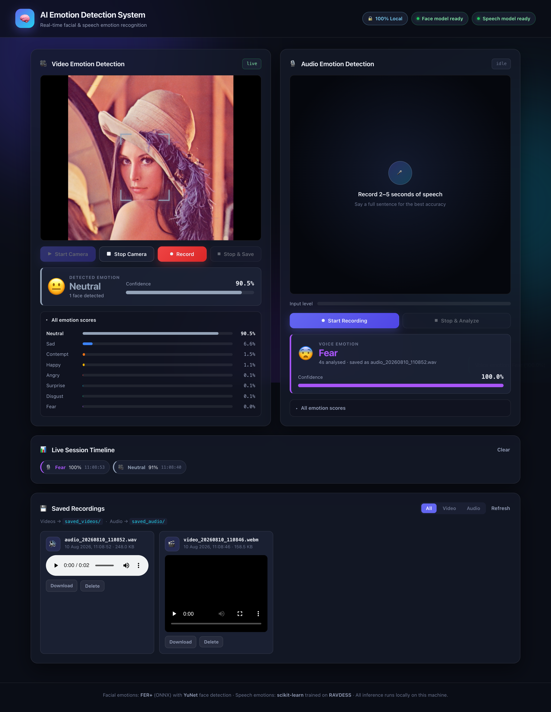

# AI Emotion Detection System

A local-first web application that recognises human emotion from **facial
expressions** (live webcam) and from **speech** (microphone recordings).

Everything runs on your own machine. There is no AWS, no S3, no Rekognition, no
DynamoDB, no cloud database and no external API of any kind. Webcam frames,
audio clips and recordings never leave the computer.



---

## What it does

| Feature | Details |
|---|---|
| Live face emotion | Webcam preview with a face-tracking overlay and per-frame classification |
| Facial emotions | All seven standard classes: **Angry · Disgust · Fear · Happy · Sad · Surprise · Neutral** |
| Video recording | Start/stop recording, saved to `saved_videos/` with a timestamped name |
| Speech emotion | Record your voice, get an emotion with a confidence score |
| Speech emotions | Neutral · Happy · Sad · Angry · Fear |
| Audio recording | Every clip saved to `saved_audio/` as a `.wav` with a timestamped name |
| Combined session | Records camera + microphone together, then merges them into one synchronised **MP4** with local FFmpeg |
| PDF report | Downloadable report with facial emotions, speech emotions, confidence scores, dominant emotions and timestamps |
| Dashboard | Result cards, confidence meters, full score breakdown, live session timeline |
| History | Browse, play back, download and delete every saved recording |

---

## Requirements

- **macOS** (developed and tested on macOS 15, Apple Silicon) — Linux and
  Windows work too, the only macOS-specific parts are the permission prompts.
- **Python 3.10 or newer.** Tested on 3.12.13.

> **Do not use Python 3.9 on macOS.** Python 3.9 caps `numpy` at 2.0.2, and that
> particular build links against Apple's Accelerate BLAS in a way that
> *segfaults* inside librosa — `chroma_stft` and `yin` both kill the
> interpreter with SIGSEGV. `numpy >= 2.1` fixes it but requires Python 3.10+.
> If you only have the system Python 3.9, install a newer one first:
>
> ```bash
> brew install python@3.12
> ```

---

## Setup

```bash
cd Emotion-Detection-System

# 1. Create a virtual environment (use python3.12 if python3 is older)
python3.12 -m venv venv
source venv/bin/activate

# 2. Install the dependencies
pip install --upgrade pip
pip install -r requirements.txt

# 3. Download the two pretrained face models (~35 MB, one time only)
python download_models.py

# 4. FFmpeg, for merging the video and audio tracks into one MP4.
#    Everything else works without it - only the merged MP4 is skipped.
brew install ffmpeg
```

### The speech model

A trained speech model is only produced by running the training script, because
the dataset it learns from is too large to ship:

```bash
# Download RAVDESS "Audio_Speech_Actors_01-24.zip" (~208 MB) from
#   https://zenodo.org/records/1188976
# and unzip it so the layout is data/ravdess/Actor_01/03-01-01-....wav

python train_audio_model.py
```

Training takes a few minutes and writes `models/audio_emotion_model.joblib`.
Add `--no-augment` for a faster run at roughly four points lower accuracy.

The app still starts without this file — the video half works normally and the
audio panel reports that the speech model is missing.

---

## Running it

```bash
source venv/bin/activate
python app.py
```

Then open:

### **http://127.0.0.1:5000**

Use `PORT=8000 python app.py` if port 5000 is taken (on macOS it often is —
AirPlay Receiver listens there; you can turn it off in
*System Settings ▸ General ▸ AirDrop & Handoff*).

The first time you press **Start Camera** or **Start Recording**, macOS asks for
camera and microphone permission for your browser. If you dismissed the prompt,
re-enable it in *System Settings ▸ Privacy & Security ▸ Camera / Microphone*.

> Use `127.0.0.1` or `localhost`, not your LAN IP. Browsers only expose
> `getUserMedia` on a secure origin, and plain-HTTP localhost is the one
> non-HTTPS origin that counts as secure.

---

## How it works

### Facial emotion

Two ONNX models run through `onnxruntime` (CoreML on Apple Silicon, CPU
elsewhere):

1. **YuNet** (`face_detection_yunet_2023mar.onnx`, 230 KB) finds the faces.
2. **FER+** (`emotion-ferplus-8.onnx`, 35 MB) classifies the largest face into
   eight emotions. FER+ is the re-annotated version of FER2013 in which every
   image was scored by ten people, so its probabilities are much better
   calibrated than the original FER2013 models.

The browser samples the preview about three times a second, downscales the
frame to 480 px wide and POSTs it as JPEG to `/api/video/analyze`. The server
crops the face and runs FER+. Predictions are averaged over the last three
frames because raw per-frame output flickers — a single blink can flip the top
class.

Inference costs about **4–15 ms per frame**, so it comfortably keeps up.

#### Getting all seven emotions out of FER+

Out of the box this pipeline answered **Neutral or Happy for ~70% of all
frames** and essentially never said Fear or Disgust. That is not a UI problem —
it is FER+'s own class bias, and it is measurable. Scored over the full
7178-image FER2013 test set, the untouched model gives:

| | Angry | Disgust | Fear | Happy | Sad | Surprise | Neutral |
|---|---|---|---|---|---|---|---|
| recall, before | 39% | 20% | **6%** | 88% | 24% | 77% | 92% |
| recall, after | 41% | 67% | 18% | 88% | 48% | 75% | 75% |

Three changes, each verified by measurement rather than by eye:

1. **Prior correction (the big one).** FER+ was trained on data dominated by
   neutral and happy faces, and it inherits that prior. The fix is standard
   logit adjustment: divide the predicted probabilities by the model's own
   class prior and renormalise (`p / prior**tau`). The prior is *measured* —
   it is the model's mean predicted probability per class over the FER2013 test
   set, stored as `MODEL_PRIOR` in `utils/video_emotion.py`. `tau` was chosen by
   sweeping it on one half of the test set and confirming on the untouched
   other half.
2. **Dropped `contempt`.** FER+ emits eight classes; the eighth is contempt,
   which is not one of the seven standard emotions and has no ground truth in
   FER2013. Once the prior correction is applied it starts winning frames it
   should not.
3. **Removed histogram equalisation, and fixed the crop.** `cv2.equalizeHist`
   sounds like it should help with bad lighting, but FER+ was trained on
   un-equalised crops and it cost 4 points of balanced accuracy — it cut
   Surprise recall from 75% to 50%. The crop padding was also wrong: running
   YuNet over canonical FER2013 crops shows its box covers 81% of the width but
   97% of the height, so the padding has to be asymmetric (11.5% / 1.8%), not
   the symmetric 10% used before.

Measured on the held-out half of the FER2013 test set:

| | Accuracy | Mean per-class recall | Classes ever predicted |
|---|---|---|---|
| Before | 56.8% | 49.7% | 6 of 7 |
| After | **60.5%** | **58.8%** | **7 of 7** |

Both numbers went up, so this is not a precision-for-recall trade — the model
was simply mis-calibrated for this task.

Two honest caveats. **Fear is still the weakest class at 18% recall**; it is
the hardest emotion in FER2013 and is mostly confused with surprise and sadness,
so treat a Fear reading with scepticism. And the smoothing window was shortened
from six frames to three: six frames at the old poll rate averaged over more
than three seconds, which was long enough to erase a brief smile entirely.

### Speech emotion

A scikit-learn pipeline trained on **RAVDESS** (24 actors, 1 440 clips).

Each clip is trimmed of silence, peak-normalised, cropped to a 4-second window
and reduced to a **623-dimensional feature vector**: MFCCs and their first and
second derivatives, chroma, spectral contrast, a mel spectrogram, spectral
centroid/rolloff/bandwidth/flatness, zero-crossing rate, RMS energy and YIN
pitch statistics. Every one of those is summarised over time by **mean, standard
deviation, minimum and maximum** — keeping the spread and extremes rather than
the mean alone is what separates an animated voice from a flat one, and it was
worth about six accuracy points on its own.

`extract_features()` in `utils/audio_emotion.py` is shared by training and
inference on purpose. If the two ever drifted apart the model would silently
produce nonsense.

#### Honest accuracy

The train/test split is made **by actor**: six of the 24 speakers are held out
entirely. A random file-level split would let the model memorise individual
voices and report a far higher — and meaningless — number.

| Model | Held-out accuracy (5 classes, chance = 20 %) |
|---|---|
| Baseline: mean/std features, no augmentation | 50.8 % |
| \+ richer time statistics | 56.8 % |
| \+ pitch/noise/speed augmentation (**shipped**) | **59.5 %** |

Per-class F1 on the held-out speakers:

| Emotion | Precision | Recall | F1 |
|---|---|---|---|
| Angry | 0.68 | 0.75 | 0.71 |
| Neutral | 0.70 | 0.68 | 0.69 |
| Fear | 0.52 | 0.67 | 0.59 |
| Happy | 0.51 | 0.58 | 0.54 |
| Sad | 0.48 | 0.25 | 0.33 |

**Sad is the weak class** and is mostly mistaken for Neutral. That is expected:
RAVDESS's "calm" recordings are folded into Neutral here, and calm and sad
speech are both low-arousal and low-pitch-variance, so they genuinely overlap.
Anger and neutral speech are recognised reliably; treat a "Sad" prediction with
scepticism.

Augmentation matters because 24 speakers is not many — pitch-shifting, adding
hiss and changing the speed stop the network from simply memorising voices. It
is applied to the training half only; augmenting the test half would inflate
the score.

### Recording

Video is captured with `MediaRecorder` (VP9/VP8 WebM, or MP4 on Safari) and
uploaded to `/api/video/save`.

Audio deliberately does **not** use `MediaRecorder`. It is captured through the
Web Audio API and encoded to 16-bit PCM WAV in the browser, because
`MediaRecorder` would produce WebM/Opus and librosa cannot decode that without
help. WAV it reads natively.

### Combined session, merged MP4 and PDF report

**Start Session Recording** runs both recorders at once. On stop the browser
uploads the video track, the WAV and every facial-emotion sample it collected
to `/api/session/save`, which then:

1. saves the video and the audio as their own files — **the originals are always
   kept**, merging never consumes them;
2. classifies the speech emotion from the WAV;
3. muxes the two into `saved_recordings/session_<timestamp>.mp4` (H.264 + AAC)
   with the local `ffmpeg` binary;
4. renders `saved_reports/report_<timestamp>.pdf`.

**On synchronisation:** the two recorders cannot start on the same instant, so
the browser reports both start times and the difference is passed to ffmpeg as
`-itsoffset` on whichever track began later. Without that the audio sits a few
hundred milliseconds out, which is very audible on speech.

Steps 3 and 4 are best-effort. If `ffmpeg` is not installed the originals and
the PDF are still returned, with a warning shown on the dashboard, rather than
failing the whole request.

The PDF contains the session length and timestamp, the dominant facial emotion
and the dominant speech emotion, the full distribution of facial emotions with
mean and peak confidence, every speech result, and a frame-by-frame timeline.

---

## Project structure

```
Emotion-Detection-System/
├── app.py                     # Flask app and JSON API
├── download_models.py         # fetches the two ONNX face models
├── train_audio_model.py       # trains the speech model on RAVDESS
├── requirements.txt
├── README.md
│
├── templates/
│   └── index.html             # the dashboard
├── static/
│   ├── css/style.css
│   └── js/script.js           # capture, recording, WAV encoding, UI
│
├── utils/
│   ├── video_emotion.py       # YuNet + FER+ facial emotion detector
│   ├── audio_emotion.py       # features + speech-emotion classifier
│   ├── media_merge.py         # ffmpeg video+audio muxing
│   └── report.py              # PDF emotion report
│
├── models/                    # ONNX models + trained .joblib pipeline
├── saved_videos/              # recorded video, timestamped
├── saved_audio/               # recorded audio, timestamped
├── saved_recordings/          # merged MP4s
├── saved_reports/             # PDF emotion reports
└── data/ravdess/              # training dataset (not committed)
```

### API

| Method | Route | Purpose |
|---|---|---|
| `GET` | `/` | Dashboard |
| `GET` | `/api/status` | Which models loaded, and why one did not |
| `POST` | `/api/video/analyze` | `{image: dataURL}` → emotion, confidence, face boxes |
| `POST` | `/api/video/save` | Multipart upload → `saved_videos/` |
| `POST` | `/api/audio/analyze` | Multipart WAV → saves to `saved_audio/` and classifies |
| `POST` | `/api/session/save` | Video + WAV + emotion samples → originals, merged MP4, PDF report |
| `GET` | `/api/recordings` | Everything saved on disk |
| `GET` | `/recordings/<kind>/<name>` | Stream or download one recording (`video`, `audio`, `merged`, `report`) |
| `DELETE` | `/api/recordings/<kind>/<name>` | Delete one recording |

Filenames are `video_YYYYMMDD_HHMMSS.webm` and `audio_YYYYMMDD_HHMMSS.wav`. The
timestamp only has one-second resolution, so a `_2`, `_3`… suffix is appended
when two recordings land in the same second — otherwise they would silently
overwrite each other.

---

## Troubleshooting

| Symptom | Fix |
|---|---|
| "Face model missing" | `python download_models.py` |
| Merged MP4 not produced | `brew install ffmpeg`, then restart `app.py` |
| "Speech model missing" | `python train_audio_model.py` (needs RAVDESS in `data/ravdess/`) |
| `Port 5000 is in use` | `PORT=8000 python app.py`, or disable AirPlay Receiver |
| Camera/mic prompt never appears | Open `127.0.0.1`, not a LAN IP — `getUserMedia` needs a secure origin |
| Permission denied | *System Settings ▸ Privacy & Security ▸ Camera / Microphone* |
| Interpreter segfaults during training | You are on Python 3.9 with numpy 2.0.2 — use Python 3.10+ (see Requirements) |
| Edits to `style.css` / `script.js` do not show up | Browser cache — hard-reload with **⌘⇧R**. (Template edits reload automatically.) |

---

## Notes and limitations

- FER+ reads **facial expression**, not inner feeling. A posed smile scores as
  Happy. This is a pattern classifier, not a mind reader, and it should not be
  used to make judgements about people.
- The speech model was trained on North-American acted English. Accuracy on
  spontaneous speech, other languages or other accents will be lower than the
  59.5 % reported above.
- The confidence figure is the model's own softmax output. Neural networks are
  routinely overconfident on inputs unlike anything they were trained on, so a
  high percentage on unusual audio does not mean the answer is trustworthy.
- The server binds to `127.0.0.1` only, so nothing on your network can reach it.

## Credits

- **FER+** — ONNX Model Zoo, Barsoum et al., *Training Deep Networks for Facial
  Expression Recognition with Crowd-Sourced Label Distribution* (ICMI 2016).
- **YuNet** — OpenCV Zoo, Wu et al.
- **RAVDESS** — Livingstone & Russo (2018), *The Ryerson Audio-Visual Database
  of Emotional Speech and Song*, CC BY-NC-SA 4.0.


## Reports and tests

Each saved session writes a PDF and a CSV to `saved_reports/`. The CSV follows the
observer sheet (`Emotion_timeline.csv`): one row per emotion, one column per 20-second
interval (`0-20`, `21-40`, ...), extended for longer recordings. An `X` marks the most
frequent facial emotion in that interval (ties go to the higher mean confidence);
intervals with no face are listed in the comments. The speech result is one 4-second
window of the whole recording, so it is reported as a note, not split by interval.

Run the tests (synthetic data only): `venv/bin/python -m unittest discover tests`

### Report downloads

| After you... | Buttons | Files |
|---|---|---|
| finish a combined session | Download PDF Report, Download CSV Report | `report_<stamp>.pdf/.csv` |
| Record, then Stop & Save (video panel) | Download Video Emotion PDF/CSV Report | `video_report_<stamp>.pdf/.csv` |
| Start Recording, then Stop & Analyze (audio panel) | Download Audio Emotion PDF/CSV Report | `audio_report_<stamp>.pdf/.csv` |

The buttons appear under the controls of the panel you used. Every recording in Saved Recordings also lists its own reports, and the Reports filter shows all of them.
